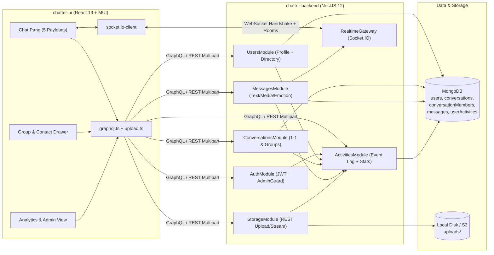

# Architecture & MVP Implementation Plan (`sa_zalo_ott_service`)

> **Role:** Senior Software Architect  
> **Project:** `sa_zalo_ott_service` (Chatter — Zalo-inspired OTT Messaging Service)  
> **Design Reference:** [docs/system-data-flow.md](./docs/system-data-flow.md)

---

## 1. Current Codebase Audit & Run Status

### 1.1 Repository Structure & Tech Stack Summary
The repository is organized as a containerized two-package web monorepo (`chatter-backend` and `chatter-ui`), orchestrated via [docker-compose.yml](./docker-compose.yml) and accompanied by a Vietnamese architecture specification in [docs/system-data-flow.md](./docs/system-data-flow.md).

| Layer / Component | Current Technology in Codebase | Status & Notes |
| :--- | :--- | :--- |
| **Container & Proxy Layer** | **Docker Compose** (`mongo:7`, `node:22-alpine`, `nginx:alpine` on `3000:80`) | **Working & Verified.** [nginx.conf](./chatter-ui/nginx.conf) serves the SPA and proxies `/graphql`, `/uploads`, and `/socket.io/` to `http://chatter-backend:4000`. |
| **Backend Framework** | **NestJS 12** (`@nestjs/core`, `@nestjs/platform-express` on Express 5), **Node.js ESM** (`"type": "module"`, TypeScript 6.0.2, `nodenext`) | Implemented in [chatter-backend/package.json](./chatter-backend/package.json) & containerized in [chatter-backend/Dockerfile](./chatter-backend/Dockerfile). |
| **API Layer** | **GraphQL (Code-First)** via `@nestjs/graphql` v14 & `@apollo/server` v5 (`autoSchemaFile: 'schema.gql'`) + basic REST (`AppController`) | Implemented in [app.module.ts](./chatter-backend/src/app.module.ts) on port `4000`. |
| **Database & ODM** | **MongoDB 7** with **Mongoose 9.11** (`@nestjs/mongoose` v12) | Schemas implemented for `users`, `conversations`, `conversationMembers`. Missing `messages` and `userActivities`. |
| **Authentication & Security** | Custom **HMAC-SHA256 JWT** (`node:crypto` in [auth-token.service.ts](./chatter-backend/src/auth/auth-token.service.ts), 8h TTL) + **scrypt** password hashing ([password.ts](./chatter-backend/src/users/password.ts)) with timing-safe comparison | Working in code & verified via `/graphql`; `AuthGuard` verifies Bearer token and checks active user status in MongoDB on every request. |
| **Frontend Framework** | **React 19.3** + **TypeScript 4.9** bootstrapped with `react-scripts` 5.0.1 (Create React App) | Implemented in [chatter-ui/package.json](./chatter-ui/package.json) & containerized in [chatter-ui/Dockerfile](./chatter-ui/Dockerfile). |
| **UI Component Library** | **Material UI (MUI v9.5)** (`@mui/material`, `@mui/icons-material`, `@emotion/react`, `@fontsource/roboto`) + **React Router v7** | Zalo-inspired blue/white palette (`#0866ff` / `#0190f3`) in [Auth.tsx](./chatter-ui/src/component/auth/Auth.tsx) and [Dashboard.tsx](./chatter-ui/src/component/auth/Dashboard.tsx). |
| **Frontend API Client** | Native `fetch` GraphQL wrapper ([graphql.ts](./chatter-ui/src/services/graphql.ts)) defaulting to `/graphql` + `window.sessionStorage` (`chatter.accessToken`) | Works identically on `localhost:3000` and AWS EC2 public IP behind Nginx. |
| **Real-Time (WebSocket)** | **None installed yet** (Nginx `/socket.io/` upgrade proxy ready; no `@nestjs/websockets`, `socket.io`, or `socket.io-client` yet) | Planned in `docs/system-data-flow.md` to use Socket.IO after REST/GraphQL message persistence. |
| **Media / File Storage** | **Volume & proxy ready** (`/app/uploads` volume + Nginx `/uploads` proxy; no Multer upload/stream controller yet) | Planned in `docs/system-data-flow.md` to store binary files outside MongoDB and keep metadata in `messages.attachments`. |
| **Push Notifications (FCM)** | **None installed yet** (No `firebase-admin` or `firebase` web SDK) | Not present in repo. |
| **Video Call / WebRTC** | **None installed yet** (No WebRTC signaling, PeerJS, or ZegoCloud SDK) | Not present in repo. |
| **Testing & Linting** | Backend: **Vitest 4.1** + `supertest` + `oxlint`. Frontend: **Jest** (`react-scripts test`) + `@testing-library/react` | Unit tests exist for `UsersService`, `AuthService`, `AuthTokenService`, `ConversationsService`, `Auth.tsx`, and `Dashboard.tsx`. |

### 1.2 Build, Containerization & Live Run Verification Results
We resolved all initial startup blockers and verified the entire stack end-to-end with Docker Compose (`docker compose up -d --build`):

1. **Startup Blockers Resolved:**
   - **Dependency & Workspace Cleanup:** Removed misplaced `@nestjs/config`, `@nestjs/mongoose`, `mongoose`, and `joi` packages from root [package.json](./package.json) and [chatter-ui/package.json](./chatter-ui/package.json), fixed `allowBuilds` in [chatter-backend/pnpm-workspace.yaml](./chatter-backend/pnpm-workspace.yaml), and fixed the ESM production entrypoint (`node dist/main.js`) in [chatter-backend/package.json](./chatter-backend/package.json).
   - **Port, CORS & Env Validation Alignment:** Updated [main.ts](./chatter-backend/src/main.ts) to listen on `0.0.0.0:4000` with CORS (`origin: true, credentials: true`), added `AUTH_JWT_SECRET` (min 32 chars) and `PORT` validation to [app.module.ts](./chatter-backend/src/app.module.ts), and defaulted `REACT_APP_GRAPHQL_URL` to `/graphql` in [graphql.ts](./chatter-ui/src/services/graphql.ts).
   - **Full Stack Containerization:** Added [chatter-backend/Dockerfile](./chatter-backend/Dockerfile), [chatter-ui/Dockerfile](./chatter-ui/Dockerfile), [chatter-ui/nginx.conf](./chatter-ui/nginx.conf), [.env.example](./.env.example), and [docker-compose.yml](./docker-compose.yml).

2. **Live End-to-End Verification (`PASS`):**
   - `sa-zalo-mongodb` (`mongo:7`), `sa-zalo-backend` (`node:22-alpine` on port `4000`), and `sa-zalo-ui` (`nginx:alpine` on port `3000:80`) built and started cleanly (`healthy`).
   - Verified `GET http://localhost:3000/` and `GET http://localhost:3000/login` (`200 OK` React SPA).
   - Verified `POST http://localhost:3000/graphql` through Nginx reverse proxy for `health`, `register`, `login`, `me`, `openDirectConversation`, and `createGroup` against MongoDB.

---

## 2. Requirement Gap Matrix

Every mandatory sub-feature and extended feature has been audited against the actual source code in `chatter-backend` and `chatter-ui`:

| Category | Sub-Feature | Status | Codebase Evidence & Implementation Details |
| :--- | :--- | :--- | :--- |
| **1. Account & Group Management** | **User Registration & Login** | `[DONE]` | Backend: `register` & `login` mutations ([auth.resolver.ts](./chatter-backend/src/auth/auth.resolver.ts)), `scrypt` hashing ([password.ts](./chatter-backend/src/users/password.ts)), HMAC-SHA256 JWT ([auth-token.service.ts](./chatter-backend/src/auth/auth-token.service.ts)). Frontend: [Login.tsx](./chatter-ui/src/component/auth/Login.tsx) (with 1-click demo accounts), [Signup.tsx](./chatter-ui/src/component/auth/Signup.tsx), [Router.tsx](./chatter-ui/src/component/Router.tsx). |
| **1. Account & Group Management** | **Profile Management** | `[DONE]` | Backend: `updateMyProfile`, `changeMyPassword` ([users.service.ts](./chatter-backend/src/users/users.service.ts)), and `POST /uploads/avatar` ([uploads.controller.ts](./chatter-backend/src/storage/uploads.controller.ts)). Frontend: [ProfileDialog.tsx](./chatter-ui/src/component/profile/ProfileDialog.tsx). |
| **1. Account & Group Management** | **Contact / Friend List & User Lookup** | `[DONE]` | Backend: `contacts` collection ([contact.schema.ts](./chatter-backend/src/users/schemas/contact.schema.ts)), `myContacts`, `addContact`, `removeContact`, `searchUsers`. Frontend: [ContactsDirectoryPanel.tsx](./chatter-ui/src/component/contacts/ContactsDirectoryPanel.tsx) with live online presence & 1-click direct chat. |
| **1. Account & Group Management** | **Group Creation** | `[DONE]` | Backend: `createGroup` ([conversations.service.ts](./chatter-backend/src/conversations/conversations.service.ts)). Frontend: Group creation dialog in [Dashboard.tsx](./chatter-ui/src/component/auth/Dashboard.tsx). |
| **1. Account & Group Management** | **Group Member Management (Add/Remove/Roles/Leave/Transfer Owner)** | `[DONE]` | Backend: `addGroupMember`, `removeGroupMember`, `setGroupAdmin`, `transferGroupOwnership`, `updateGroupTitle`, `leaveGroup` ([conversations.resolver.ts](./chatter-backend/src/conversations/conversations.resolver.ts)). Frontend: [GroupInfoDrawer.tsx](./chatter-ui/src/component/chat/GroupInfoDrawer.tsx). |
| **1. Account & Group Management** | **Admin / System-Level Account & Group Management** | `[DONE]` | Backend: [admin.guard.ts](./chatter-backend/src/auth/admin.guard.ts), `adminUsers`, `adminSetUserStatus`, `adminSetUserRole`, `adminConversations`, `adminSetConversationClosed`. Frontend: [AdminManagementPanel.tsx](./chatter-ui/src/component/admin/AdminManagementPanel.tsx). |
| **1. Account & Group Management** | **QR Login** | `[MISSING]` | Deferred to Phase 2 (Extended Features). |
| **2. 1-1 & Group Chat** | **Real-Time WebSocket Messaging (`Socket.IO`)** | `[DONE]` | Backend: [realtime.gateway.ts](./chatter-backend/src/realtime/realtime.gateway.ts) (JWT handshake, rooms, live message/reaction/delete broadcasts, typing indicators & online presence). Frontend: [realtime.ts](./chatter-ui/src/services/realtime.ts). |
| **2. 1-1 & Group Chat** | **Payload 1: Text Messages (Send, History Pagination, Recall/Delete, Reply)** | `[DONE]` | Backend: [messages.service.ts](./chatter-backend/src/messages/messages.service.ts) (`messages`, `sendMessage`, `deleteMessage`, cursor pagination, reply quotes). Frontend: [ChatWindow.tsx](./chatter-ui/src/component/chat/ChatWindow.tsx). |
| **2. 1-1 & Group Chat** | **Payload 2: Image Messages** | `[DONE]` | Backend: [storage.service.ts](./chatter-backend/src/storage/storage.service.ts) (10 MB limit, MIME validation, HMAC-signed URLs). Frontend: Multi-image upload, inline grid & lightbox zoom in [ChatWindow.tsx](./chatter-ui/src/component/chat/ChatWindow.tsx). |
| **2. 1-1 & Group Chat** | **Payload 3: Video Messages** | `[DONE]` | Backend: 50 MB limit + Express byte-range (`206 Partial Content`) streaming in [uploads.controller.ts](./chatter-backend/src/storage/uploads.controller.ts). Frontend: Inline `<video controls>` player in [ChatWindow.tsx](./chatter-ui/src/component/chat/ChatWindow.tsx). |
| **2. 1-1 & Group Chat** | **Payload 4: Document (File Attachment) Messages** | `[DONE]` | Backend: 25 MB limit (`PDF`, Office, `TXT`, `CSV`, `ZIP`) with safe `Content-Disposition: attachment`. Frontend: File badge card + download button in [ChatWindow.tsx](./chatter-ui/src/component/chat/ChatWindow.tsx). |
| **2. 1-1 & Group Chat** | **Payload 5: Emotion (Reactions / Stickers / Emojis)** | `[DONE]` | Backend: `kind = emotion` (`stickerCode`/emoji) + `reactToMessage` / `removeMessageReaction`. Frontend: [emotions.ts](./chatter-ui/src/constants/emotions.ts) Zalo sticker pack, quick emoji picker, and message reaction bar in [ChatWindow.tsx](./chatter-ui/src/component/chat/ChatWindow.tsx). |
| **3. User Activity Statistics** | **Activity Event Logging (`userActivities` collection)** | `[DONE]` | Backend: [user-activity.schema.ts](./chatter-backend/src/activities/schemas/user-activity.schema.ts) & [activities.service.ts](./chatter-backend/src/activities/activities.service.ts) with strict metadata sanitization. |
| **3. User Activity Statistics** | **Analytics Aggregation API & Dashboard UI** | `[DONE]` | Backend: `activityStats` (Admin DAU/MAU, daily series, 5-payload counts, media storage bytes, top groups) & `myActivitySummary` ([activities.resolver.ts](./chatter-backend/src/activities/activities.resolver.ts)). Frontend: [AnalyticsDashboard.tsx](./chatter-ui/src/component/analytics/AnalyticsDashboard.tsx). |
| **4. Extended Features** | **Zalo-Inspired Web UI** | `[DONE]` | Complete Zalo-inspired blue/white responsive UI across Auth, Chat, Group Info Drawer, Contacts Directory, Profile Modal, Analytics Dashboard, and System Admin Panel. |
| **4. Extended Features** | **Firebase Cloud Messaging (FCM)** | `[MISSING]` | Deferred to Phase 2 (Extended Features). |
| **4. Extended Features** | **Video Call Integration (WebRTC / ZegoCloud)** | `[MISSING]` | Deferred to Phase 2 (Extended Features). |

---

## 3. Functional Requirements (FR)

To guarantee a rock-solid, demonstrable system without over-engineering, requirements are strictly split into **Phase 1 (MVP — Mandatory Core Requirements)** and **Phase 2 (Extended Features)**.

### Phase 1: MVP (Strictly Covering the 3 Mandatory Requirement Groups)

#### FR-1: Account, Profile, Directory & Group Management
- **FR-1.1 (Auth & Session):** Users can register (`register`), log in (`login`), and validate their active session (`me`) using HMAC-SHA256 Bearer tokens. Disabled accounts (`status = disabled`) are immediately rejected by both `login` and `AuthGuard`.
- **FR-1.2 (Profile Management):** Authenticated users can update their `displayName`, `avatarUrl` (or upload an avatar image), and password via an `updateMyProfile` / `changeMyPassword` mutation and a Profile dialog in the sidebar.
- **FR-1.3 (Contact / User Directory):** Authenticated users can search active users by email or display name (`searchUsers` query, paginated, excluding `passwordHash`) and maintain/view their contacts in the "Danh bạ" tab to start 1-1 chats or invite to groups.
- **FR-1.4 (Group Lifecycle & Member Roles):**
  - Users can create groups (`createGroup`) with 1–99 other active users; creator becomes `owner`.
  - `owner` and `admin` can add (`addGroupMember`) and remove (`removeGroupMember`) members (only `owner` can remove an `admin`).
  - `owner` can promote/demote `admin` (`setGroupAdmin`) and transfer group ownership (`transferGroupOwnership`) to another active member.
  - Non-owner members can leave (`leaveGroup`), and the UI provides an interactive Group Info drawer to perform all member management actions.
- **FR-1.5 (System Admin Account & Group Management):**
  - Users with `role = admin` can list/search all accounts (`adminUsers`), toggle account status between `active` and `disabled` (`adminSetUserStatus`), promote/demote system roles (`adminSetUserRole`), and list/close/reopen conversations (`adminConversations`, `adminCloseConversation`).

#### FR-2: 1-1 & Group Real-Time Chat (5 Mandatory Payload Types)
- **FR-2.1 (Conversation & Message Persistence):**
  - Active conversation members can fetch paginated message history (`messages(conversationId, before, limit)`) ordered by `{ createdAt: -1, _id: -1 }`.
  - Sending a message updates `conversations.lastMessageAt` and sender's `lastReadAt`, and supports optional `replyToId` and message recall/soft-delete (`deleteMessage` sets `deletedAt`, `deletedBy`).
- **FR-2.2 (5 Mandatory Payload Types):**
  1. **Text (`kind = text`):** Non-empty trimmed text up to 4,000 characters.
  2. **Image (`kind = image`):** Uploaded image (`image/jpeg`, `image/png`, `image/gif`, `image/webp`, max 10 MB) stored via the storage service, rendered inline with lightbox preview.
  3. **Video (`kind = video`):** Uploaded video (`video/mp4`, `video/webm`, max 50 MB) stored via the storage service, rendered with an inline HTML5 `<video controls>` player.
  4. **Document (`kind = document`):** Uploaded file attachment (`application/pdf`, `.doc`, `.docx`, `.xls`, `.xlsx`, `.ppt`, `.pptx`, `.txt`, `.zip`, max 25 MB) rendered as a downloadable file card showing original filename, MIME badge, and file size.
  5. **Emotion (`kind = emotion` + Message Reactions):**
     - **Message Reactions:** Any active member can react to any message (`reactToMessage(messageId, emoji)` / `removeMessageReaction(messageId)`) with standard emojis (`👍`, `❤️`, `😂`, `😮`, `😢`, `😡`), upserted per `(messageId, userId)` in `messages.reactions`.
     - **Standalone Emotion / Sticker Message (`kind = emotion`):** Users can send a standalone big emoji / Zalo-style sticker message from an Emotion picker in the chat composer.
- **FR-2.3 (Real-Time Delivery via WebSocket / Socket.IO):**
  - Authenticated Socket.IO gateway (`/chat` namespace) verifies the Bearer JWT on connection handshake and joins the socket to rooms for the user's active `conversationId`s (`conversation:<id>`) and personal notifications (`user:<id>`).
  - Emits real-time server-to-client events after database persistence: `message.created`, `message.deleted`, `message.reaction_updated`, `conversation.updated`, and `member.updated`.
  - Supports lightweight typing indicators (`typing.start`, `typing.stop`) and read receipts (`conversation.read`).

#### FR-3: User Activity Statistics (Analytics Module)
- **FR-3.1 (Activity Audit Logging):**
  - Record sanitized, privacy-safe events in `userActivities` after successful operations: `account.created`, `login.succeeded`, `conversation.created`, `group.member_added`, `group.member_removed`, `message.sent` (with `metadata.kind`), `message.reaction_added`, `message.deleted`, and `file.uploaded` (with `metadata.kind`, `metadata.sizeBytes`, `metadata.mimeType`).
  - Never log plaintext message text, passwords, tokens, or signed URLs.
- **FR-3.2 (Analytics Aggregation API & Dashboard):**
  - Provide an admin-protected GraphQL query `activityStats(from: DateTime!, to: DateTime!, timezone: String)` and a user-level summary `myActivitySummary(days: Int)` (so both admin and regular demo users can inspect analytics).
  - Metrics computed via MongoDB Aggregation Pipelines:
    - **Overview KPIs:** Total registered accounts (`active` vs `disabled`), Active Users in period (DAU / MAU based on distinct `actorId` with `login.succeeded` or `message.sent`), New Accounts created, New Groups created, Active Groups count.
    - **Message Volume Breakdown:** Total messages sent and daily time-series breakdown segmented by the 5 payload types (`text`, `image`, `video`, `document`, `emotion`) + recalled messages.
    - **Media & Storage Usage:** Total file count and total storage bytes (`sizeBytes`) segmented by media type (`image`, `video`, `document`).
    - **Group Member Activity:** Total member additions and removals over the date range.
  - Render an interactive **Thống kê (Analytics)** view in `chatter-ui` with date-range pickers, KPI summary cards, daily bar/line charts, and payload/storage breakdown tables.

---

### Phase 2: Extended Features (Post-MVP)
- **FR-4 (QR Code Login):** Desktop web generates a short-lived QR session token (`qrSession.created`) via WebSocket; an already-authenticated session scans/approves the token (`approveQrSession`), issuing a JWT to the waiting desktop client in real time.
- **FR-5 (Video & Audio Call Integration):** 1-1 and Group audio/video calling using WebRTC (`RTCPeerConnection`) with Socket.IO signaling (`call.invite`, `call.accept`, `call.reject`, `call.ice-candidate`, `call.hangup`) or ZegoCloud UIKit SDK.
- **FR-6 (Firebase Cloud Messaging — FCM Push Notifications):** Register browser/device FCM tokens (`registerPushToken`) and dispatch background push notifications via `firebase-admin` when a user receives a message while offline.

---

## 4. Non-Functional Requirements (NFR)

1. **Real-Time Latency (WebSocket):**
   - End-to-end message delivery latency (from sender mutation/emit to connected recipient UI render via Socket.IO room broadcast) **< 150 ms** on local/LAN environments and **< 300 ms** p95 under normal load.
2. **Media Upload Size, Validation & Throughput:**
   - Strict server-side file size limits: **10 MB** for images, **25 MB** for documents, **50 MB** for videos.
   - Server-side MIME type allowlist, blocked-extension list, and file-signature (magic-byte) check that the content matches the declared type (`StorageService.assertContentMatchesType`); streaming/multipart upload via REST endpoint (`POST /api/uploads/:conversationId`) so binary payloads never pass through GraphQL JSON serialization.
3. **Concurrency & Pagination:**
   - Support at least **100 concurrent WebSocket connections** per Node.js instance and up to **100 members per group**.
   - Cursor-based pagination (`before` timestamp/ID + `limit <= 50`) on `messages` and `userActivities` queries to guarantee constant-time $O(\log N)$ index scans and prevent unbounded memory growth.
4. **Security & Access Control:**
   - **Authentication:** HMAC-SHA256 JWT (minimum 256-bit secret) verified on every GraphQL request (`AuthGuard`), REST upload/download route, and Socket.IO connection handshake.
   - **Authorization:** Strict active-membership checks (`requireActiveMembership`) before reading/sending messages or accessing conversation media; role-based guards (`owner`/`admin` for group management; `UserRole.ADMIN` for system administration and global analytics).
   - **Data Privacy:** `scrypt` password hashing with 16-byte random salt and `timingSafeEqual`; `passwordHash` excluded at schema level (`select: false`); zero PII/message content in `userActivities`.
5. **Scalability & Maintainability:**
   - Stateless JWT authentication and modular NestJS domain boundaries (`UsersModule`, `AuthModule`, `ConversationsModule`, `MessagesModule`, `StorageModule`, `ActivitiesModule`, `RealtimeModule`).
   - Pluggable storage adapter interface (`StorageService`) defaulting to local disk storage (`uploads/` with authenticated streaming controller) for zero-config local demos, while supporting S3/MinIO/GCS swap via environment variables.

---

## 5. Technical & Architecture Decisions (Minimal-Refactoring Strategy)

To deliver 100% of the MVP cleanly on top of the existing codebase without breaking existing tests or rewriting working modules:

### 5.1 Keep GraphQL for Business Logic + Add REST Multipart for Media + Socket.IO for Real-Time
- **Why:** The existing frontend ([graphql.ts](./chatter-ui/src/services/graphql.ts)) and backend (`AuthModule`, `ConversationsModule`) already use GraphQL mutations/queries with `AuthGuard`. Keeping GraphQL for `sendMessage`, `reactToMessage`, `deleteMessage`, `messages`, and `activityStats` requires zero changes to the existing frontend data-fetching pattern.
- **Media Upload & Protected Delivery (`StorageModule`):** Instead of adding complex GraphQL multipart upload middleware that conflicts with Express 5 / Apollo 5, add a dedicated NestJS REST controller (`UploadsController`):
  - `POST /uploads/:conversationId` (protected by `AuthGuard` + `FileInterceptor` from `@nestjs/platform-express` / `multer`): validates active membership, file size, and MIME type, writes to `<repo>/chatter-backend/uploads/<conversationId>/<uuid>-<sanitizedName>`, logs `file.uploaded` in `userActivities`, and returns `{ storageKey, originalName, mimeType, sizeBytes, uploadedAt, url }`.
  - `GET /uploads/:conversationId/:fileName` (protected by Bearer token or short-lived HMAC query signature): verifies membership and streams the file with appropriate `Content-Type` and `Content-Disposition` headers.
- **Real-Time Broadcast (`RealtimeModule`):**
  - Add `@nestjs/websockets`, `@nestjs/platform-socket.io`, and `socket.io` to `chatter-backend`, and `socket.io-client` to `chatter-ui`.
  - follows the exact pattern specified in [docs/system-data-flow.md](./docs/system-data-flow.md#L148): **Persist via GraphQL mutation first, then broadcast the saved entity through `RealtimeGateway`**. This guarantees that even if a WebSocket temporarily disconnects, the GraphQL call succeeds and data is never lost.

### 5.2 Supporting All 5 Chat Payload Types in `MessagesModule`
- Extend the `MessageKind` enum in `messages/entities/message.entity.ts` to explicitly support all 5 required payload types plus system events:
  - `TEXT = 'text'`
  - `IMAGE = 'image'`
  - `VIDEO = 'video'`
  - `DOCUMENT = 'document'`
  - `EMOTION = 'emotion'` (for standalone sticker/big-emoji messages)
  - `SYSTEM = 'system'`
- **Embedded Reactions on Every Message:** Store `reactions: Array<{ userId: string; emoji: string; createdAt: Date }>` directly on the `messages` document (as designed in [docs/system-data-flow.md](./docs/system-data-flow.md#L80)). Upserting a reaction updates the array in-place using MongoDB atomic operators and broadcasts `message.reaction_updated` to the conversation room.

### 5.3 Designing the User Activity Statistics (`ActivitiesModule`) with Minimal Coupling
- Create an injectable `ActivitiesService` with a non-blocking/safe `record(event: CreateActivityEvent)` method and MongoDB schema `UserActivityRecord` (`collection: 'userActivities'`) indexed on `{ occurredAt: 1, type: 1 }` and `{ actorId: 1, occurredAt: 1 }`.
- Inject `ActivitiesService` into:
  - `AuthService` -> logs `account.created` on `register()` and `login.succeeded` on `login()`.
  - `ConversationsService` -> logs `conversation.created`, `group.member_added`, and `group.member_removed`.
  - `MessagesService` -> logs `message.sent` (with `metadata: { kind, attachmentCount }`), `message.reaction_added` (with `metadata: { emoji }`), and `message.deleted`.
  - `StorageService` -> logs `file.uploaded` (with `metadata: { kind, mimeType, sizeBytes }`).
- For the **Analytics Dashboard (`activityStats` query)**, run a parallel `Promise.all` of focused MongoDB aggregations over `users`, `conversations`, `messages`, and `userActivities` to return:
  - `totalUsers`, `activeUsersCount` (DAU/MAU over selected range), `newUsersCount`, `newGroupsCount`, `activeGroupsCount`.
  - `messagesByKind` (`text`, `image`, `video`, `document`, `emotion`), `dailyActivity` (array of `{ date, activeUsers, messagesSent, filesUploaded }`), `mediaUsage` (count & total `sizeBytes` per media type), and `groupMemberEvents` (`added`, `removed`).

---

## 6. Step-by-Step MVP Implementation Roadmap

Execute the following ordered tasks to bring the MVP to 100% completion and demo readiness:

### Step 1: Environment, Containerization & Port Alignment (`[DONE]`)
1. `[DONE]` Fixed [chatter-backend/pnpm-workspace.yaml](./chatter-backend/pnpm-workspace.yaml), ESM `start:prod` (`node dist/main.js`), and cleaned up extraneous NestJS/Mongoose packages from root [package.json](./package.json) and [chatter-ui/package.json](./chatter-ui/package.json).
2. `[DONE]` Updated [chatter-backend/src/main.ts](./chatter-backend/src/main.ts) to listen on `0.0.0.0:4000` with CORS (`origin: true, credentials: true`) and added `AUTH_JWT_SECRET` + `PORT` validation to [app.module.ts](./chatter-backend/src/app.module.ts).
3. `[DONE]` Updated [chatter-ui/src/services/graphql.ts](./chatter-ui/src/services/graphql.ts) to default `REACT_APP_GRAPHQL_URL` to `/graphql` and created [.env.example](./.env.example) + [chatter-backend/.env.example](./chatter-backend/.env.example).
4. `[DONE]` Containerized the entire stack ([docker-compose.yml](./docker-compose.yml), [chatter-backend/Dockerfile](./chatter-backend/Dockerfile), [chatter-ui/Dockerfile](./chatter-ui/Dockerfile), [chatter-ui/nginx.conf](./chatter-ui/nginx.conf)) and verified `docker compose up -d --build` end-to-end on `http://localhost:3000`.

### Step 2: Account, Profile, Directory & Admin Backend (`[DONE]`)
1. `[DONE]` Added `lastSeenAt` to [user.schema.ts](./chatter-backend/src/users/schemas/user.schema.ts) and implemented `updateMyProfile`, `changeMyPassword`, `searchUsers`, and `contacts` management (`myContacts`, `addContact`, `removeContact`) in [users.service.ts](./chatter-backend/src/users/users.service.ts) and [auth.resolver.ts](./chatter-backend/src/auth/auth.resolver.ts).
2. `[DONE]` Implemented `transferGroupOwnership`, `updateGroupTitle`, and `markConversationRead` in [conversations.service.ts](./chatter-backend/src/conversations/conversations.service.ts).
3. `[DONE]` Created [admin.guard.ts](./chatter-backend/src/auth/admin.guard.ts) and implemented system-level administration (`adminUsers`, `adminSetUserStatus`, `adminSetUserRole`, `adminConversations`, `adminSetConversationClosed`).

### Step 3: User Activity Logging & Analytics Backend (`[DONE]`)
1. `[DONE]` Created [user-activity.schema.ts](./chatter-backend/src/activities/schemas/user-activity.schema.ts), [activity-stats.entity.ts](./chatter-backend/src/activities/entities/activity-stats.entity.ts), [activities.service.ts](./chatter-backend/src/activities/activities.service.ts), and [activities.resolver.ts](./chatter-backend/src/activities/activities.resolver.ts).
2. `[DONE]` Wired sanitized activity logging across Auth, Conversations, Messages, and Storage, and verified DAU/MAU, daily series, 5-payload distribution, media storage bytes, and active group aggregations.

### Step 4: Media Storage & All 5 Chat Payload Types (`[DONE]`)
1. `[DONE]` Created [storage.service.ts](./chatter-backend/src/storage/storage.service.ts) and [uploads.controller.ts](./chatter-backend/src/storage/uploads.controller.ts) supporting authenticated multipart uploads, avatar uploads, HMAC-signed URLs, and HTTP Range (`206 Partial Content`) video streaming.
2. `[DONE]` Created [messages.service.ts](./chatter-backend/src/messages/messages.service.ts) and [messages.resolver.ts](./chatter-backend/src/messages/messages.resolver.ts) supporting `text`, `image`, `video`, `document`, and `emotion` (stickers/emojis + message reactions), cursor pagination, reply quotes, and soft recall (`deleteMessage`).

### Step 5: Real-Time WebSocket Gateway (`[DONE]`)
1. `[DONE]` Created [realtime.gateway.ts](./chatter-backend/src/realtime/realtime.gateway.ts) with JWT handshake verification, conversation/user rooms, live message/reaction/recall broadcasts, typing indicators, and online presence tracking.

### Step 6: Complete Frontend UI (`chatter-ui`) (`[DONE]`)
1. `[DONE]` Built [ChatWindow.tsx](./chatter-ui/src/component/chat/ChatWindow.tsx) supporting all 5 payload types, lightbox preview, HTML5 video player, document download cards, Zalo sticker pack & reactions, reply quotes, message recall, and live typing indicators.
2. `[DONE]` Built [GroupInfoDrawer.tsx](./chatter-ui/src/component/chat/GroupInfoDrawer.tsx), [ContactsDirectoryPanel.tsx](./chatter-ui/src/component/contacts/ContactsDirectoryPanel.tsx), [ProfileDialog.tsx](./chatter-ui/src/component/profile/ProfileDialog.tsx), [AnalyticsDashboard.tsx](./chatter-ui/src/component/analytics/AnalyticsDashboard.tsx), and [AdminManagementPanel.tsx](./chatter-ui/src/component/admin/AdminManagementPanel.tsx).

### Step 7: End-to-End Verification & Demo Seed (`[DONE]`)
1. `[DONE]` Added idempotent startup demo seeding in [seed.service.ts](./chatter-backend/src/seed/seed.service.ts) (`admin@chatter.vn` + 3 demo users, mutual contacts, 1-1 & group chats, document attachment, reactions, and 7-day historical activity data).
2. `[DONE]` Passed all 8 backend Vitest unit test suites (23 tests), compiled backend & frontend Docker images cleanly, and verified all MVP workflows end-to-end through `http://localhost:3000`.
