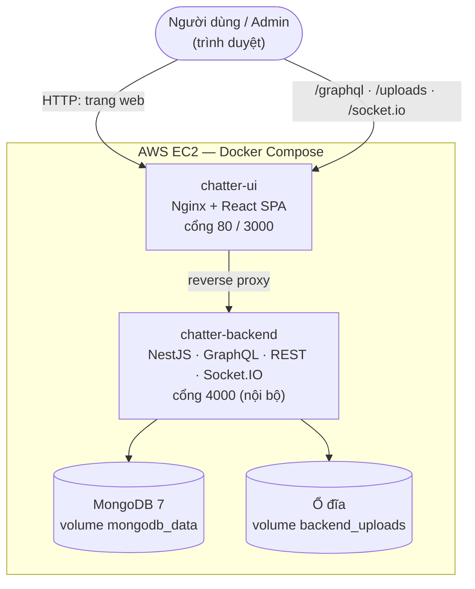
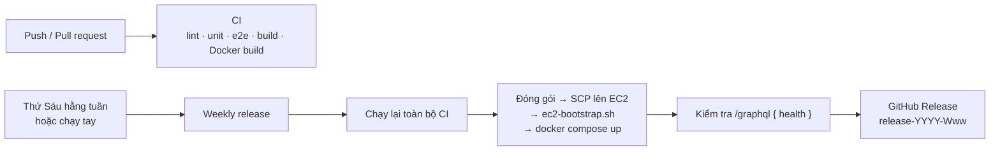

# Báo cáo kiến trúc — Hệ thống OTT giả lập Zalo (Chatter)

Môn Kiến trúc phần mềm (MH_CO5185), HK1 2026–2027. Tài liệu này đối chiếu đề bài ([Detai2026.pdf](./Detai2026.pdf)) với hệ thống đã xây dựng, và trình bày các giải pháp kiến trúc đã áp dụng.

Tài liệu liên quan:
- [system-data-flow.md](./system-data-flow.md): mô hình dữ liệu và luồng nghiệp vụ chi tiết.
- [PLAN.md](../PLAN.md): yêu cầu chức năng (FR), phi chức năng (NFR) và lộ trình triển khai.

---

## 1. Đối chiếu yêu cầu đề bài

### 1.1 Yêu cầu chức năng

Mỗi yêu cầu đều có test e2e chạy trên toàn bộ ứng dụng với MongoDB thật ([test/app.e2e-spec.ts](../chatter-backend/test/app.e2e-spec.ts)).

| Yêu cầu đề bài | Đã đáp ứng bằng | Code chính | Test e2e (`describe` / `it`) |
| :--- | :--- | :--- | :--- |
| Quản lý tài khoản | Đăng ký, đăng nhập, hồ sơ, đổi mật khẩu, danh bạ, tìm người dùng; admin khoá/mở và phân quyền tài khoản | `auth/`, `users/` | *1. Account and group management*; *System administration* |
| Quản lý danh sách nhóm | Tạo nhóm, thêm/xoá thành viên, phó nhóm, chuyển trưởng nhóm, đổi tên, rời nhóm; admin xem và đóng nhóm | `conversations/` | *creates a group and manages its members*; *lets an admin list and close groups* |
| Chat 1-1 và chat nhóm | Hội thoại `DIRECT` và `GROUP`, lịch sử có phân trang, trả lời, thu hồi, đã đọc, đang gõ, trạng thái online | `conversations/`, `messages/`, `realtime/` | Mọi test trong *2. 1-1 and group chat* chạy cho cả `[direct]` và `[group]` |
| Text | `kind = text`, tối đa 4.000 ký tự | `messages/` | *sends a text message and a reaction* |
| Image | Ảnh JPEG/PNG/GIF/WEBP ≤ 10 MB | `storage/`, `messages/` | *sends a image the other member can download* |
| Video | MP4/WEBM/MOV ≤ 50 MB, phát trực tiếp bằng HTTP Range | `storage/` | *sends a video the other member can download* |
| Document | PDF, Office, TXT, CSV, ZIP ≤ 25 MB | `storage/` | *sends a document the other member can download* |
| Emotion | Sticker/emoji độc lập (`kind = emotion`) và thả cảm xúc lên tin nhắn | `messages/` | *sends an emotion sticker*; *…and a reaction* |
| Thống kê hoạt động người dùng | Ghi nhật ký hoạt động; thống kê cho admin (DAU/MAU, theo ngày, theo 5 loại tin, dung lượng media, nhóm sôi nổi nhất); thống kê cá nhân | `activities/` | *3. User activity statistics* |

### 1.2 Yêu cầu về quy trình và công nghệ

| Yêu cầu đề bài | Cách đáp ứng |
| :--- | :--- |
| Requirement | FR/NFR và ma trận yêu cầu trong [PLAN.md](../PLAN.md) §2–4 |
| Design | Mô hình dữ liệu và luồng trong [system-data-flow.md](./system-data-flow.md); kiến trúc và quyết định thiết kế trong tài liệu này (§2–4) |
| Code | `chatter-backend` (NestJS), `chatter-ui` (React); nhánh `feature/mobile-app` có thêm client mobile |
| Test | Unit test (Vitest, Jest), e2e test với MongoDB thật, CI chạy mỗi lần push (§6) |
| Deploy | Docker Compose; deploy lên AWS EC2 bằng script hoặc workflow GitHub Actions (§5) |
| Release lên Cloud theo tuần | Workflow [weekly-release.yml](../.github/workflows/weekly-release.yml) chạy mỗi thứ Sáu: chạy lại toàn bộ CI → deploy lên EC2 → kiểm tra health → tạo GitHub Release `release-YYYY-Www` |
| Backend Node.js, NoSQL | NestJS 12 trên Node.js 22, MongoDB 7 |
| Frontend web | React 19 + Material UI (SPA) |

---

## 2. Kiến trúc tổng thể

### 2.1 Sơ đồ container (C4 mức 2)



Chỉ container `chatter-ui` được mở ra Internet. MongoDB và backend chỉ nghe trên `127.0.0.1` của máy chủ ([docker-compose.prod.yml](../docker-compose.prod.yml)). Mọi lời gọi API, upload và WebSocket đều đi qua Nginx ([nginx.conf](../chatter-ui/nginx.conf)), nên trình duyệt chỉ thấy một origin duy nhất và không cần cấu hình CORS.

### 2.2 Kiểu kiến trúc: modular monolith, phân lớp

Backend là **một tiến trình duy nhất, chia thành các module theo nghiệp vụ**. Mỗi module có cấu trúc phân lớp giống nhau:

```text
Resolver / Controller   ← nhận request (GraphQL, REST), kiểm tra quyền bằng Guard
        │
     Service            ← quy tắc nghiệp vụ, kiểm tra thành viên, ghi nhật ký
        │
  Mongoose Model        ← truy cập dữ liệu (schema + index)
```

| Module | Trách nhiệm |
| :--- | :--- |
| `AuthModule` | Đăng ký/đăng nhập, cấp và xác thực token, `AuthGuard`, `AdminGuard` |
| `UsersModule` | Tài khoản, hồ sơ, danh bạ, băm mật khẩu |
| `ConversationsModule` | Hội thoại 1-1, nhóm, thành viên và vai trò |
| `MessagesModule` | Tin nhắn 5 loại, cảm xúc, thu hồi, phân trang |
| `StorageModule` | Upload/download file, kiểm tra loại file, URL có chữ ký |
| `RealtimeModule` | Socket.IO: phòng theo hội thoại/người dùng, presence, typing |
| `ActivitiesModule` | Nhật ký hoạt động và các truy vấn thống kê |
| `SeedModule` | Dữ liệu demo khi khởi động |

**Vì sao chọn modular monolith thay vì microservices:** nhóm 3–4 người, thời gian 11 tuần, tải ở mức demo. Một tiến trình duy nhất giúp deploy đơn giản (một image), giao dịch giữa các module là lời gọi hàm, và dễ debug. Ranh giới module rõ ràng (mỗi module chỉ dùng service export của module khác) nên sau này có thể tách `RealtimeModule` hoặc `ActivitiesModule` thành service riêng mà không phải viết lại nghiệp vụ.

### 2.3 Ba kiểu giao tiếp, mỗi kiểu một việc

| Kênh | Dùng cho | Lý do |
| :--- | :--- | :--- |
| **GraphQL** (`/graphql`) | Mọi truy vấn và thao tác nghiệp vụ | Client chọn đúng trường cần lấy (ví dụ danh sách hội thoại kèm thành viên trong một request); schema có kiểu, tự sinh từ code ([schema.gql](../chatter-backend/schema.gql)) |
| **REST multipart** (`/uploads`) | Upload và tải file | File nhị phân không phải mã hoá vào JSON; tải video hỗ trợ HTTP Range (`206 Partial Content`) để tua |
| **WebSocket** (Socket.IO) | Đẩy sự kiện từ server: tin mới, thu hồi, cảm xúc, đang gõ, online | Người nhận thấy tin ngay, không cần hỏi lại server liên tục |

---

## 3. Giải pháp và mẫu thiết kế đã áp dụng

| Giải pháp / mẫu | Áp dụng ở đâu | Lợi ích |
| :--- | :--- | :--- |
| **Dependency Injection / IoC** | Toàn bộ NestJS: service được inject qua constructor | Thay dependency bằng mock khi unit test (ví dụ [messages.service.spec.ts](../chatter-backend/src/messages/messages.service.spec.ts)) |
| **Guard (cross-cutting concern)** | [auth.guard.ts](../chatter-backend/src/auth/auth.guard.ts), [admin.guard.ts](../chatter-backend/src/auth/admin.guard.ts) | Xác thực và phân quyền tách khỏi nghiệp vụ, khai báo bằng `@UseGuards` |
| **Repository / Data Mapper** | Mongoose model trong từng `schemas/` | Nghiệp vụ không phụ thuộc trực tiếp vào driver MongoDB |
| **Publish–Subscribe** | [realtime.gateway.ts](../chatter-backend/src/realtime/realtime.gateway.ts): phòng `conversation:<id>` và `user:<id>` | Người gửi không cần biết ai đang online; mọi socket trong phòng đều nhận sự kiện |
| **Persist-then-broadcast** | `MessagesService`: lưu MongoDB xong mới phát sự kiện socket | Mất kết nối socket không làm mất tin; client tải lại từ GraphQL là đủ |
| **Event log cho thống kê** (gần với CQRS: tách phía ghi và phía đọc) | Các service gọi `ActivitiesService.record()`; thống kê dùng aggregation pipeline trên `userActivities` | Thêm chỉ số mới không phải sửa nghiệp vụ chat; nhật ký không chứa nội dung tin nhắn hay mật khẩu |
| **Facade** | `StorageService` gom kiểm tra loại file, giới hạn dung lượng, lưu đĩa, ký URL | Controller và seed chỉ gọi một hàm |
| **Reverse proxy / API gateway** | Nginx trong `chatter-ui` | Một cổng vào duy nhất; ẩn backend và database khỏi Internet |
| **Stateless authentication** | Token HMAC-SHA256 tự ký ([auth-token.service.ts](../chatter-backend/src/auth/auth-token.service.ts)) | Không lưu session trên server, nên có thể chạy nhiều bản backend |
| **Mô hình hoá dữ liệu NoSQL** | Cảm xúc nhúng trong tin nhắn; `lastMessagePreview` lưu sẵn trên hội thoại; thu hồi bằng `deletedAt` (soft delete) | Mở danh sách chat và lịch sử chỉ cần một truy vấn, không cần join |
| **Cursor pagination + compound index** | `messages(before, limit)` với index `{conversationId, createdAt, _id}` | Tải lịch sử nhanh như nhau dù hội thoại dài bao nhiêu |
| **Externalized configuration** | `ConfigModule` + Joi kiểm tra biến môi trường khi khởi động | Thiếu `AUTH_JWT_SECRET` hay `MONGODB_URI` thì app dừng ngay với thông báo rõ ràng |

---

## 4. Thuộc tính chất lượng và chiến thuật (tactics)

| Thuộc tính | Chiến thuật | Bằng chứng |
| :--- | :--- | :--- |
| **Bảo mật** | Băm mật khẩu `scrypt` có salt, so sánh `timingSafeEqual`; `passwordHash` không bao giờ được trả về (`select: false`); kiểm tra thành viên trước mọi thao tác chat và file; kiểm tra **nội dung file khớp với loại khai báo** (chặn file `.exe` đổi tên thành `.png`); chặn đuôi file nguy hiểm; URL tải file có chữ ký HMAC và hạn dùng; tài khoản bị khoá mất quyền ngay cả với token cũ | e2e: *rejects disallowed file types…*, *disables an account…*, *stops a removed member…*; unit: [storage.service.spec.ts](../chatter-backend/src/storage/storage.service.spec.ts), [auth-token.service.spec.ts](../chatter-backend/src/auth/auth-token.service.spec.ts) |
| **Hiệu năng** | WebSocket thay cho polling; index phù hợp từng truy vấn; phân trang theo cursor; thống kê chạy song song bằng `Promise.all` | Đo tại máy local: tin nhắn tới người nhận qua socket sau **~32 ms** (mục tiêu NFR < 150 ms) |
| **Tính sẵn sàng** | Health check cho từng container (`depends_on: service_healthy`); `restart: unless-stopped`; dữ liệu và file nằm trên Docker volume | [docker-compose.yml](../docker-compose.yml) |
| **Khả năng sửa đổi** | Module theo nghiệp vụ; nhật ký hoạt động tách khỏi chat; schema GraphQL sinh từ code | Thêm loại tin mới chỉ cần sửa `MessageKind` và `StorageService` |
| **Khả năng kiểm thử** | DI cho phép mock; e2e chạy trên database riêng tự xoá | §6 |
| **Khả năng triển khai** | Docker multi-stage (build và chạy unit test ngay trong image); một lệnh `docker compose up`; CI/CD tự động | §5 |

---

## 5. Triển khai và release lên Cloud



- **CI** ([ci.yml](../.github/workflows/ci.yml)) chạy ở mọi lần push và pull request. Gồm: lint, unit test, e2e test (MongoDB chạy dạng service container), build backend; type check, test, build frontend; cuối cùng build Docker image cho cả hai.
- **Release hằng tuần** ([weekly-release.yml](../.github/workflows/weekly-release.yml)) tự chạy lúc 10:00 thứ Sáu (giờ Việt Nam), hoặc chạy tay từ tab Actions. Workflow chỉ deploy khi CI pass, và báo lỗi nếu app không trả lời health check sau khi deploy.
- **Cấu hình cần làm một lần:** tạo EC2 bằng [scripts/provision-and-deploy-ec2.ps1](../scripts/provision-and-deploy-ec2.ps1), sau đó thêm secret `EC2_HOST` và `EC2_SSH_KEY` (nội dung file `.pem`) trong *Settings → Secrets and variables → Actions* của repo.
- Lịch `schedule` của GitHub Actions chỉ chạy trên nhánh mặc định (`main`).

---

## 6. Kiểm thử

| Tầng | Công cụ | Phạm vi | Số lượng |
| :--- | :--- | :--- | :--- |
| Unit (backend) | Vitest | Service: tài khoản, xác thực, token, hội thoại, tin nhắn, thống kê, kiểm tra file | 9 file, 43 test |
| E2E (backend) | Vitest + `fetch` + `socket.io-client` | Toàn bộ app với MongoDB thật: cả 3 nhóm yêu cầu, phân quyền, realtime | 29 test |
| Component (frontend) | Jest + React Testing Library | Form đăng nhập/đăng ký, tạo chat 1-1 và nhóm trên dashboard | 6 test |

Chạy test:

```bash
cd chatter-backend
pnpm test          # unit
pnpm test:e2e      # e2e, cần MongoDB ở mongodb://localhost:27017 (đổi bằng E2E_MONGODB_URL)

cd chatter-ui
pnpm test --watchAll=false
```

E2E test tạo một database riêng tên `chatter_e2e_<thời điểm>` và xoá nó khi chạy xong, nên không ảnh hưởng dữ liệu đang dùng.

---

## 7. Quyết định kiến trúc (ADR tóm tắt)

| # | Quyết định | Phương án đã cân nhắc | Lý do chọn |
| :--- | :--- | :--- | :--- |
| ADR-1 | MongoDB (NoSQL) | MySQL | Tin nhắn có cấu trúc thay đổi theo loại (text, file đính kèm, sticker); cảm xúc nhúng trong tin nhắn; aggregation pipeline đủ cho thống kê |
| ADR-2 | Modular monolith | Microservices | Quy mô nhóm và tải hiện tại; ranh giới module vẫn cho phép tách sau này (§2.2) |
| ADR-3 | GraphQL + REST cho file + Socket.IO | Chỉ REST; GraphQL subscriptions | Mỗi kênh dùng đúng việc (§2.3); Socket.IO tự kết nối lại và có cơ chế phòng sẵn |
| ADR-4 | Lưu file trên ổ đĩa (Docker volume) | S3 | Không phát sinh chi phí và cấu hình cho demo; toàn bộ thao tác file nằm trong `StorageService` nên đổi sang S3 chỉ phải sửa một chỗ |
| ADR-5 | Token tự ký HMAC-SHA256, hạn 8 giờ | Session lưu server; thư viện JWT | Stateless; ít dependency; đã có test cho trường hợp token bị sửa hoặc hết hạn |
| ADR-6 | Nginx làm cổng vào duy nhất | Mở trực tiếp cổng backend | Một origin, không cần CORS; backend và database không lộ ra Internet |

---

## 8. Hạn chế và hướng phát triển

| Hạn chế hiện tại | Hướng phát triển |
| :--- | :--- |
| Socket.IO chỉ chạy một bản backend; chạy nhiều bản thì sự kiện không tới hết người nhận | Thêm `@socket.io/redis-adapter` và Redis, đặt backend sau load balancer |
| File lưu trên ổ đĩa của một máy | Chuyển `StorageService` sang S3 với presigned URL |
| Website trên EC2 chạy HTTP, chưa có HTTPS | Gắn domain, dùng Let's Encrypt (Caddy hoặc certbot) hoặc ALB + ACM |
| Script tạo EC2 mở SSH (cổng 22) cho mọi IP | Giới hạn theo IP của nhóm; hoặc dùng AWS SSM Session Manager |
| Chưa có thông báo đẩy, đăng nhập QR, gọi video (Phase 2 trong PLAN.md) | FCM, QR login qua WebSocket, WebRTC với Socket.IO làm kênh signaling |
| Client mobile nằm ở nhánh riêng `feature/mobile-app` | Merge vào `main` sau khi review |
| Chưa có giám sát và log tập trung | Ghi log có cấu trúc, CloudWatch; cảnh báo khi health check lỗi |

---

## 9. Thành viên và phân công

Đề bài yêu cầu nhóm 3–4 người, có nhóm trưởng và bảng phân công. Nhóm cần tự điền bảng này; cột "Commit chính" lấy từ lịch sử git.

| Thành viên | Vai trò | Phụ trách | Commit chính |
| :--- | :--- | :--- | :--- |
| *(điền tên)* | Nhóm trưởng | | |
| Linh Trang | | | Đăng ký tài khoản (MongoDB), đăng nhập JWT, giao diện chat dashboard |
| Nam Le | | | MVP Phase 1 (3 nhóm chức năng bắt buộc), deploy AWS EC2, client mobile |
| hwnghoang | | | Khởi tạo React UI, NestJS, CI/CD, e2e test, báo cáo kiến trúc |
